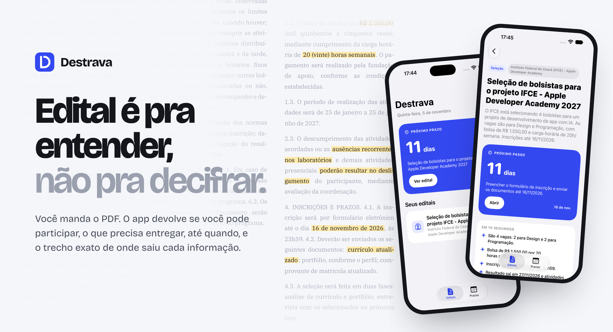
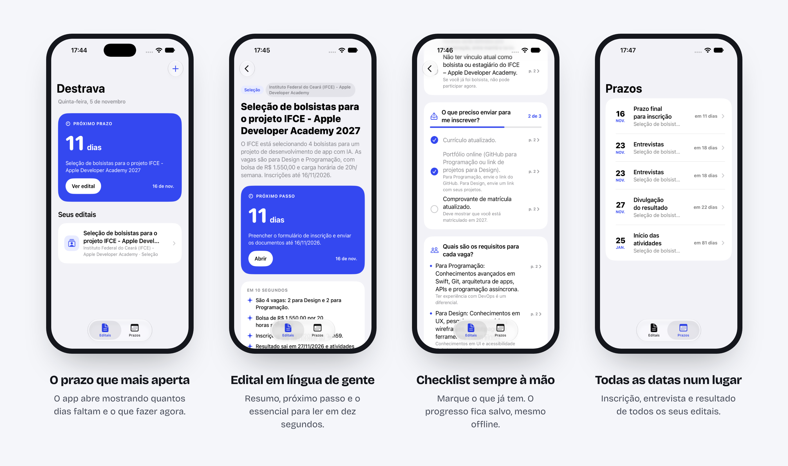
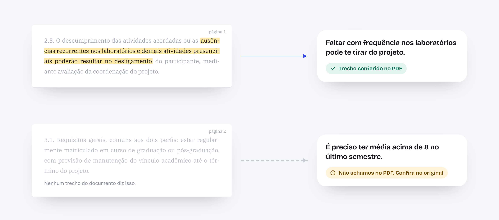
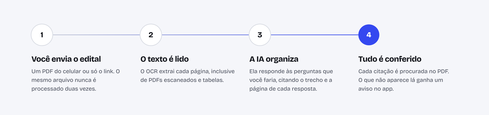

<p align="center">
  
</p>

<p align="center">
  <strong>Destrava</strong> transforma editais em respostas.<br>
  App iOS em SwiftUI, com uma API própria que lê o PDF, organiza o que importa com IA e confere cada informação no documento original.
</p>

<br>

## O problema

Bolsa, estágio, auxílio estudantil, vestibular, concurso: quase toda oportunidade
pública chega como um edital. São dez, vinte, cinquenta páginas escritas para
cumprir a lei, não para serem lidas. A informação que decide a vida de alguém,
como o prazo, o documento que falta ou a regra que elimina, fica no meio de
parágrafos numerados.

Quem tem tempo e costume encontra. Quem está começando, trabalha o dia inteiro
ou não está acostumado com essa linguagem perde prazo, esquece um comprovante ou
nem tenta. O Destrava existe para que entender um edital não seja uma vantagem
de poucos.

## O que ele faz

<p align="center">
  
</p>

Você manda o PDF, do celular ou só pelo link. Pouco depois, o edital vira uma
tela organizada pelas perguntas que você faria a quem já leu:

- **Posso participar?** Os requisitos e os impedimentos, em frases curtas.
- **O que eu preciso fazer agora?** O próximo passo, com o prazo e um botão para resolver.
- **O que preciso entregar?** Um checklist que guarda o seu progresso, mesmo sem internet.
- **Quando acontece cada coisa?** As datas de todos os seus editais numa linha do tempo só.
- **Tem alguma pegadinha?** As regras que podem te eliminar aparecem destacadas.
- **O que o edital não diz?** O que você esperaria encontrar e não está lá, com o contato de quem pode responder.

As perguntas não são fixas. Um edital de bolsa gera "Quanto eu ganho?", o do
ENEM gera "O que levar no dia da prova?", e uma licitação gera "Quem pode
concorrer?". O app desenha qualquer resposta a partir de seis tipos de bloco
(lista, checklist, etapas, valores, tabela e texto), então funciona com
documentos que ninguém previu.

## Nada é inventado

<p align="center">
  
</p>

Um resumo errado de edital pode custar uma vaga. Por isso o Destrava não pede
para você confiar na IA: toda informação vem com o trecho literal e a página de
onde saiu, e um toque mostra o original.

Antes de chegar ao app, cada citação é procurada no texto do PDF, ignorando
acentos, maiúsculas e quebras de linha. Se ela está lá, a informação ganha o selo
de conferida e a página é corrigida se a IA tiver errado. Se não está, o app
avisa com todas as letras. A IA organiza, o documento comprova.

## Como um edital é destravado

<p align="center">
  
</p>

O processamento roda em segundo plano, numa fila com limite de editais
simultâneos. O app consulta o andamento e abre o edital assim que ele fica pronto.

A IA não está presa a nenhum fornecedor. A API depende só de dois contratos, um
para ler o PDF e outro para organizar o texto, e o fornecedor de cada um é
escolhido por configuração. Hoje o projeto usa os modelos econômicos da Mistral.
Trocar por OpenAI, Anthropic ou qualquer outro é escrever uma classe nova, sem
mexer no resto. O passo a passo está no [guia da API](api/README.md).

## Por dentro

| | |
| --- | --- |
| **App** | SwiftUI, Observation (`@Observable`), SwiftData para o checklist offline, `async/await` com `URLSession`, arquitetura MVVM e interface montada a partir dos dados da API |
| **API** | NestJS e TypeScript, documentação automática com Swagger, deduplicação por hash do PDF e fila de processamento |
| **IA** | OCR e LLM como provedores plugáveis, saída estruturada por JSON Schema, normalização da resposta e conferência das citações no texto original |
| **Acessibilidade** | Dynamic Type, Dark Mode, VoiceOver com rótulos e áreas de toque de 44 pontos |

O repositório tem as duas partes lado a lado: `destrava/` é o app e `api/` é o
back-end.

## Rodando

<details>
<summary>Ver os passos</summary>

<br>

Você precisa de um Mac com o Xcode recente, Node.js 22 ou mais novo e uma chave
de API do fornecedor de IA configurado.

**API**

```bash
cd api
cp .env.example .env
npm install
npm run start:dev
```

Coloque a chave no `.env`. A documentação interativa fica em
`http://localhost:3000/docs`.

**App**

Abra `destrava.xcodeproj` no Xcode e rode no simulador. Ele se conecta à API em
`localhost:3000`.

</details>

## Próximos passos

- Guardar os editais em PostgreSQL, em vez de memória.
- Lembretes de prazo com notificações.
- Abrir o PDF original no app, já na página citada.
- Compartilhar um edital destravado por link.

<br>

<p align="center">
  Feito por <a href="https://chaaves.xyz">Gabriel Chaves</a>, estudante de Engenharia de Telecomunicações no IFCE.
</p>
